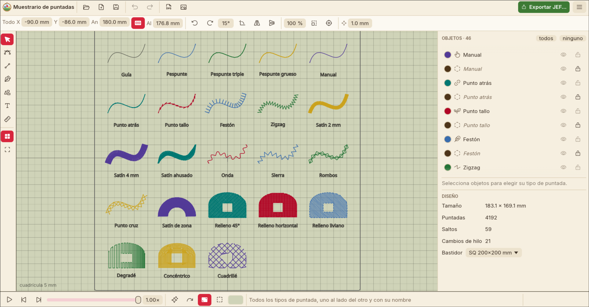

<p align="center">
  
</p>

<h1 align="center">EdenBord</h1>

<p align="center">
  Editor de bordados libre para máquinas <b>Janome</b> (archivos <code>.jef</code>), hecho en Rust.
</p>

> *«…y tu campo de flores bordado es la copia feliz del Edén.»* — Himno Nacional de Chile
>
> **Eden** viene de esa estrofa; **Bord**, de bordado.



## Qué hace

EdenBord sirve para dos cosas: **editar diseños JEF** que ya existen y **crear bordados
nuevos** desde cero o a partir de un dibujo.

### Diseños JEF

- Abre archivos `.jef` y `.jef+` (el formato editable de Janome) y los muestra con una vista
  realista del hilo sobre la tela.
- Simula el bordado puntada a puntada, para ver el orden y los saltos antes de coser.
- Edita: mover, rotar, espejar, escalar, centrar, recolorear con la paleta Janome, reordenar
  colores, borrar y combinar diseños, con deshacer.
- Muestra tamaño, puntadas, saltos, cambios de hilo y bastidor (A, B, C, F, SQ 200×200,
  SQ14b…), y avisa si el diseño no cabe.
- Guarda verificando: relee lo escrito y lo compara antes de dar el archivo por bueno.

### Proyectos `.edenbord`

Un proyecto guarda **formas** con su **tipo de puntada**, así que se puede cambiar el tamaño,
la densidad o el tipo de puntada sin perder calidad. Al final se exporta a JEF para la máquina.

- **Dibujar:** pluma (curvas y rectas), editor de nodos, figuras (rectángulo, elipse, polígono,
  estrella, corazón, gota, flecha, hoja), regla y cuadrícula.
- **Calcar:** poner una imagen de fondo y dibujar encima con la pluma.
- **Importar SVG** desde Inkscape, Illustrator u otro programa de dibujo.
- **Texto** con las fuentes instaladas en el sistema o un archivo TTF/OTF propio, escrito
  directo sobre el lienzo.
- **Combinar y booleanas:** unir, restar, intersecar y excluir zonas; separar trazados.
- **Puntadas de línea:** pespunte simple, triple y grueso, punto atrás, punto tallo, festón,
  satín (con ahusado), y motivos decorativos (onda, sierra, almenas, rombos, festones, cruces).
- **Rellenos:** tatami con ángulo, largo y patrón ajustables, degradé, concéntrico, cuadrillé y
  satín de zona, con base (bajo puntada) y compensación de tirado.
- **Satín de zona para letras:** guías de ángulo y cortes automáticos que parten las letras en
  columnas, editables a mano, y control del orden de bordado de cada columna.
- **Contorno:** cada zona puede llevar relleno, contorno o ambos, con color propio.
- Remates automáticos, cortes de hilo y orden de bordado arrastrando en la lista de objetos.
- Paleta visual de puntadas con una muestra cosida de cada una.
- Ejemplos incluidos: muestrario de puntadas, flor, marco con texto y una matriz para calibrar
  rellenos en la máquina.

### La interfaz

En español, con una distribución parecida a Inkscape: herramientas a la izquierda, barra de
opciones según la herramienta, lista de objetos y propiedades a la derecha. Copiar y pegar
funciona entre ventanas, recuerda los archivos recientes y se puede arrastrar un archivo a la
ventana para abrirlo.

| Atajo | Acción |
|---|---|
| `S` / `N` / `P` / `R` / `T` / `G` / `F` | Seleccionar, nodos, pluma, regla, texto, guías, figuras |
| `Ctrl+Z` / `Ctrl+Y` | Deshacer / rehacer |
| `Ctrl+C` / `Ctrl+X` / `Ctrl+V` | Copiar / cortar / pegar en el puntero |
| `Ctrl+Shift+V` | Pegar en el mismo lugar |
| `Ctrl+D` / `Ctrl+A` | Duplicar / seleccionar todo |
| `Supr`, flechas | Borrar, mover la selección |
| Espacio + arrastrar, rueda | Mover y acercar la vista |

## Descargas

En [Releases](../../releases) hay:

| Sistema | Archivo |
|---|---|
| Linux (Debian, Ubuntu, Mint…) | `edenbord_<versión>_amd64.deb` |
| Linux (cualquiera) | `EdenBord-<versión>-x86_64.AppImage` (darle permiso de ejecución) |
| Windows | `EdenBord-<versión>-instalador.exe` o el `.zip` portable |

El instalador de Windows asocia los archivos `.edenbord` y, si se elige, también `.jef` y
`.jef+`.

## Compilar

Hace falta [Rust](https://rustup.rs) estable.

```bash
cargo run --release -p edenbord -- [archivo.jef | proyecto.edenbord | dibujo.svg]
```

El código está organizado en tres crates:

| Crate | Qué es |
|---|---|
| `crates/jef` | Librería: lectura y escritura de JEF/JEF+, paleta Janome y operaciones de edición |
| `crates/bordado` | Librería: proyectos `.edenbord`, generación de puntadas, SVG y texto |
| `crates/edenbord` | La aplicación (egui/eframe) |

Herramientas de terminal:

```bash
cargo run -p jef --example info -- a.jef b.jef                      # resumen de archivos JEF
cargo run -p bordado --example generar -- dibujo.svg salida.jef vista.svg  # SVG/.edenbord → JEF
```

Pruebas: `cargo test --workspace`. Para probar con archivos reales, copiar
`.cargo/config.example.toml` a `.cargo/config.toml` y poner en `JEF_FIXTURES` la carpeta con
los diseños.

Paquetes: `cargo deb -p edenbord` y `packaging/appimage.sh` (ver `CLAUDE.md`).

## Formato JEF

No hay documentación oficial; el formato está descrito en [`CLAUDE.md`](CLAUDE.md) tal como se
verificó con archivos reales (incluidas sus rarezas y el JEF+). Leer y volver a escribir un
archivo da exactamente los mismos bytes.

## Pendiente

- Exportar a DST, EXP y PES.
- Archivos `.JBF` y `.ai`.
- Kerning en textos.

## Licencia

GPL-3.0 o posterior. Ver [LICENSE](LICENSE).
